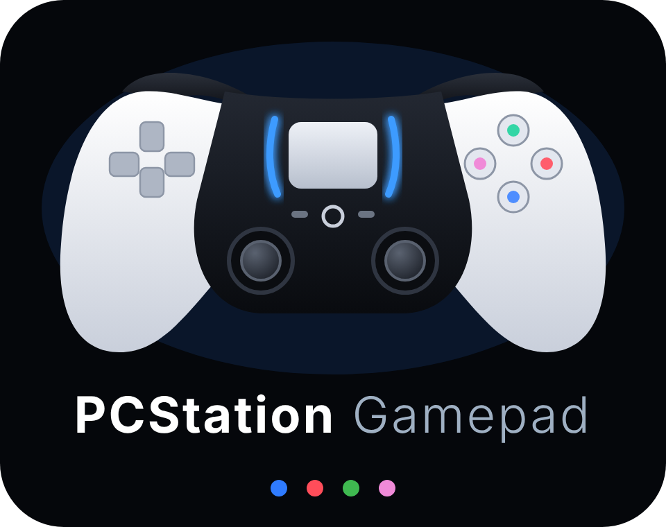

<p align="center"></p>

# PCStation Gamepad

**By Maxido Entertainment.** Turn Android phones into PS5-style gamepads for your Windows PC (up to 4 at once), and play from a fullscreen, controller-driven game launcher. No servers, no accounts, no internet needed.

- **PCStation Gamepad for Android:** full-screen DualSense-style controller (sticks, D-pad, ✕ ○ □ △, L1/R1, analog L2/R2, Create/Options/PS, touchpad, gyro aiming, customizable layout).
- **PCStation Gamepad for Windows:** receives each phone's input over Wi-Fi and shows it to games as its own virtual Xbox 360 controller (Player 1 to 4). It also opens the **Game Launcher**.

## Get the apps

Push this repo to GitHub. The **Build PCStation Gamepad** workflow (Actions tab) produces three downloads:

- `PCStation-Gamepad-Installer` → **`PCStation-Gamepad-Setup.msi`** (recommended on the PC: installs to Program Files, adds Start menu and Desktop shortcuts, opens the Wi-Fi port in the firewall, uninstalls cleanly from Windows Settings)
- `PCStation-Gamepad-Windows` → `PCStation-Gamepad.exe` (portable version, no install)
- `PCStation-Gamepad-Android` → `PCStation-Gamepad.apk` (install on every phone; allow "install unknown apps" once)

## Set up

1. **One time on the PC:** install the [ViGEmBus driver](https://github.com/nefarius/ViGEmBus/releases) (it creates the virtual controllers). The app shows a button for it if it's missing.
2. Install and run PCStation Gamepad on the PC (the MSI, or the exe).
3. Put the phones and the PC on the same network (a router, a phone hotspot, or the Windows Mobile Hotspot all work).
4. Open **PCStation Gamepad** on each phone, tap **Find my PC**, then **Connect**. Each phone becomes the next free player (P1 blue, P2 red, P3 green, P4 pink). A fifth phone sees "PC full (4/4)" until someone leaves.

## The Game Launcher

Click **Open Game Launcher** in the PC app (or tick "Open the launcher when this app starts"). It opens fullscreen in Microsoft Edge or Chrome and is laid out like a console home screen: tabs along the top, the selected game's artwork behind a row of tiles, a big title, and a **Play** button. Everything works with a controller: D-pad or left stick to move, ✕ (A) to select, ○ (B) to go back, □ (X) for options, △ (Y) to add games, ☰ for settings. Mouse and keyboard work too.

**Adding games (you choose what is saved):**
- **Scan this PC** finds installed Steam, Epic Games and GOG games. Tick the ones you want, then add them.
- **Browse for an app or game** lets you pick any program or shortcut (Chrome, an emulator, a game from another store).
- Your library is saved in `%APPDATA%\PCStationGamepad\library.json` and is there next time.
- **Pictures:** Steam artwork already cached on your PC is used automatically; missing artwork for Steam and Epic games is downloaded when online (switch this off in Settings). For anything else, choose **Change picture** in the game's options, or it gets a coloured tile with initials.

**Remove, rename, change picture:** press □ (X) on a game.

### Controllers and users

The launcher knows which controllers are connected, whether it is one or several, and what each one is: a **phone** (shown with its model and player slot), a **DualSense**, **DualShock 4**, **Xbox**, **Switch Pro** or a generic pad. Real controllers connected to the PC work in the launcher at the same time as the phones.

- The first time a controller is used, it asks **"Who's using this controller?"** and you pick a user, or create a new one. It remembers the choice next time.
- **Controllers** tab: see every controller, **change its user**, **rename** it, **identify** it (a phone buzzes, a real pad rumbles) or **forget** it.
- **Users** tab: add, rename, recolour or delete users (like console accounts).
- On-screen button hints match the controller you're using (✕ ○ □ △ for phones and PlayStation pads, A B X Y for Xbox pads).

### Startup and sounds

The launcher opens with the **Maxido Entertainment** intro, then the PCStation Gamepad logo, then the home screen (press any button to skip; switch it off in Settings). Scrolling, selecting, going back, starting a game, and controllers connecting all have their own sounds. They are synthesized live from scratch (no audio files, nothing copied), and you can turn them off in Settings. Short previews are in `branding/sound-previews/`.

## Customize the phone layout

1. On the controller screen, **press and hold the small ✎ tab** at the top centre (about half a second).
2. **Move** any control by dragging it. **Resize** it with the corner handle or the slider; "Whole pad" scales everything.
3. **Shell** hides the grey body for a free-form layout. **Reset control** / **Reset all** undo changes. Changes auto-save to the default profile.

## Notes on multiplayer

- The limit is 4 because games read Xbox 360 pads through XInput, which supports 4 controllers. `MAX_PLAYERS` in `pc/pcstation_gamepad.py` is the single setting.
- A phone that goes quiet has its buttons released after 3 s and its slot freed after 20 s; one that reconnects gets its own slot back.
- If a real Xbox controller is plugged in, it uses one of the 4 XInput slots too, so you can have 3 phones plus that pad in games that only read XInput.
- The launcher tells phones apart from real Xbox pads using the XInput slot Windows gave each virtual pad. If a game or driver reports controllers unusually, a phone may show as a plain "Xbox controller": use **Controllers → Identify** to check.

## Button mapping (virtual Xbox 360 pad)

✕=A, ○=B, □=X, △=Y, L1/R1=LB/RB, L2/R2=LT/RT (analog), Create/touchpad=Back, Options=Start, PS=Guide, tap a stick=L3/R3.

## Project structure

```
android/                           Android app (Java, no dependencies)
  .../MainActivity.java            connect screen, UDP, gyro, profile storage, startup screen
  assets/index.html                controller UI + layout editor
  assets/splash.html               animated startup screen
pc/
  pcstation_gamepad.py             Windows app: window, UDP server, up to 4 virtual pads
  pcstation_launcher.py            game detection (Steam/Epic/GOG), library, users, local server
  pcstation_launcher_ui.py         the launcher page (generated from ui_src/ by build_ui.py)
  ui_src/                          launcher source: style.css, app.js, sfx.js, index.html
  tests/                           python -m unittest discover -s pc/tests
installer/Product.wxs              MSI definition (WiX v5)
branding/                          logo, Maxido mark, icons, sound previews
.github/workflows/build.yml        builds the APK, the EXE and the MSI
```

After editing anything in `pc/ui_src/`, run `python pc/build_ui.py`.

## Build locally

- Android: `gradle -p android assembleDebug`
- PC exe: `pip install -r pc/requirements.txt pyinstaller`, then `pyinstaller --onefile --windowed --name PCStation-Gamepad --icon branding/icon.ico --collect-all vgamepad pc/pcstation_gamepad.py`
- MSI: install WiX v5 (`dotnet tool install --global wix --version 5.0.2` and `wix extension add --global WixToolset.Firewall.wixext/5.0.2`), copy `installer/Product.wxs`, `branding/icon.ico` and the exe into one folder, replace `__VERSION__` with e.g. `1.0.0`, then `wix build -arch x64 -ext WixToolset.Firewall.wixext -o PCStation-Gamepad-Setup.msi Product.wxs`

## Security

The launcher server listens only on this PC (127.0.0.1), every request needs a random per-run token, and it can only start things that are in your library. The phone port (UDP 8765) is open to your local network, so use networks you trust.
